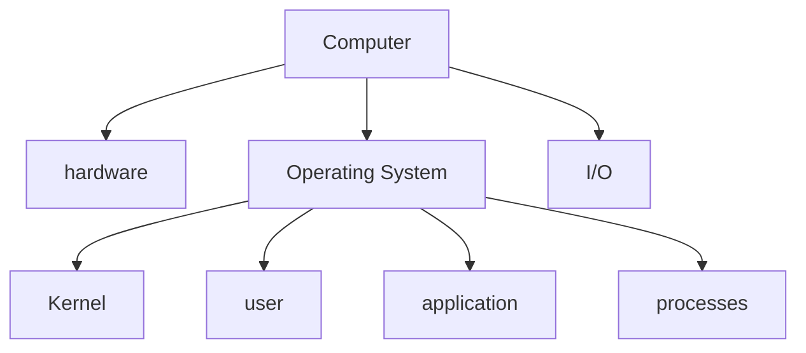

# Introduction

## Operating-system:
    an operating system is a program that connects user and hardware. its used to run program
    s on a computer efficiently and conveniently.

## Components:

    an computer system can be broken down into 4 components:



### hardware:
    hardware includes all the physical components of the computer

 ```mermaid
    
    graph TD

    A[CPU] --> B[RAM]
    B --> C[DISK]
    B --> A
    C --> B
    
```

### Operating-System:
    operating system has two parts , userspace and kernelspace. kernel space is the core
    of operating system and it allocates resources for applications, acts as middle man 
    between hardware and user and allows for virtualization

### Input & Ouput (I/O):
    input output falls under hardware, these devices acts as way for the user and computer to
    interact with each other , keyboard ,mouse,monitor etc are I/O devices

### distinction b/w application and processes:
    application usually is an executable program on your Storage device i.e HDD/SSD
    while processes are the instances of applications that is loaded onto ram and is being executed

### Multiprogramming:

    When you have multiple jobs that needs to be done , you can load the programs
    that needs to be executed and execute one after another as they finish the intented job.
    Multiprogramming increases CPU utilization in a way that your CPU always have a job to execute

### Time-Sharing systems:

    Time-sharing systems are logical extensions of Multiprogramming. It allows for multitasking
    and concurrency by switching between jobs instead of waiting for a job to finish.

### Job scheduling:
    Job scheduling is a sophisticated extension multiprogramming . suppose you have a process that
    could only run after an interrupt from I/O devices , like waiting for a keystroke etc, in such
    case the CPU doesnt execute anything , in such cases we need to switch to another process while
    also simultaneously waiting for the interrupts . The CPU switches between tasks frequently that 
    too in enormous speeds that the user doesnt notice a difference in the execution of Job scheduling.
    Job scheduling falls under Time-sharing


